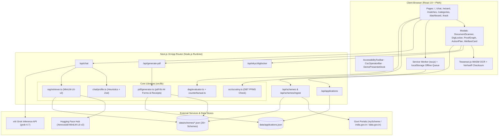
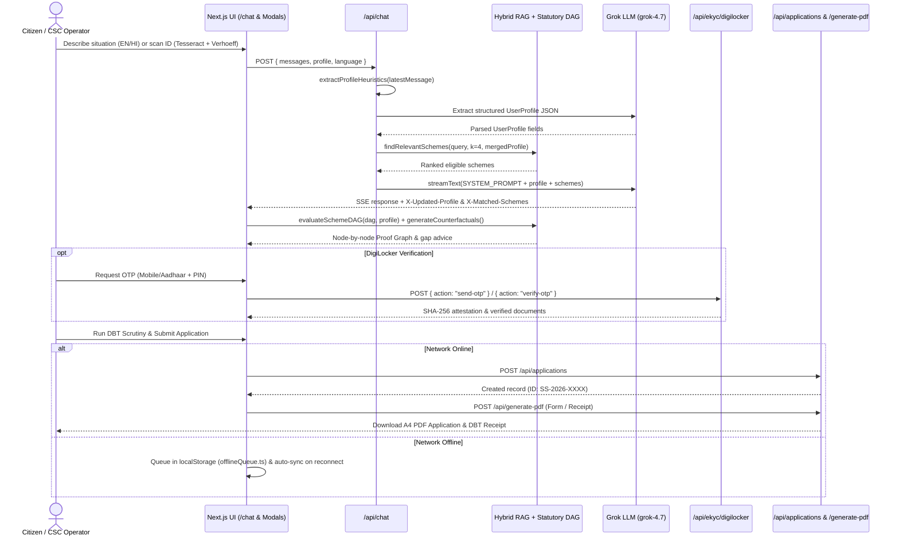
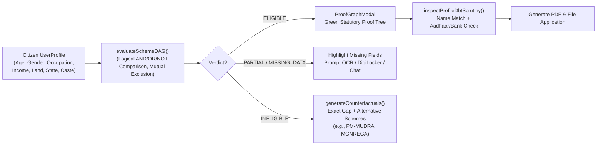
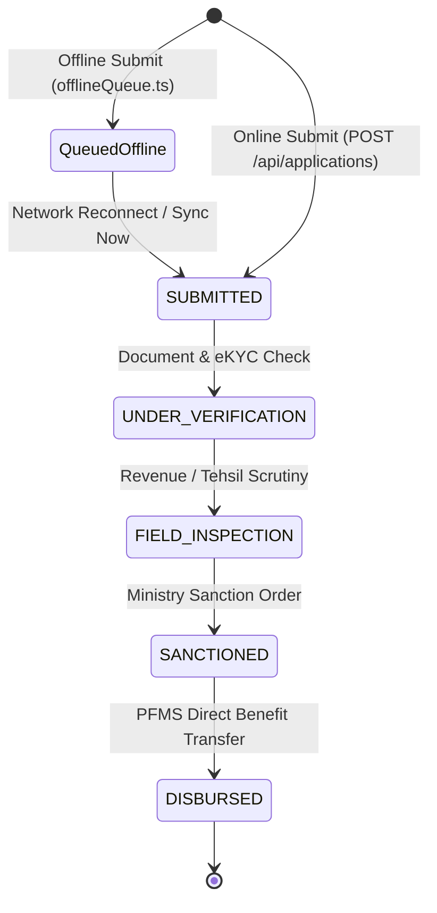

# SchemeSaathi

**SchemeSaathi** is an AI-powered, offline-ready Digital Public Infrastructure (DPI) assistant built with **Next.js 16 (App Router)** and **React 19** to help Indian citizens and Common Service Centre (CSC) operators discover, formally verify, and apply for government welfare schemes across **26+ central and state schemes** in **English and Hindi**.

---

## ✨ Key Features

- **Bilingual AI Welfare Co-Pilot (`/chat`)**: Guided, streaming conversational discovery powered by Grok (`grok-4.7`) via xAI, deterministic regex heuristics (`extractProfileHeuristics`), and hybrid semantic retrieval (`Xenova/all-MiniLM-L6-v2` embeddings + eligibility scoring) in **English (`en`)** and **Hindi (`hi`)**.
- **Formal Statutory DAG Verification & Counterfactuals**: Evaluates citizen profiles against structured boolean/comparison rule trees (`src/lib/dag/`) for transparent eligibility proofs (`ProofGraphModal`), showing exact passing/failing criteria and actionable counterfactual gap advice with alternative scheme suggestions.
- **Life-Event Bundle Navigator & 3-Step Quick-Match Wizard (`/`, `/wizard`, `/matches`)**: Discover curated multi-scheme packages triggered by life events (e.g., *Newborn & Maternity*, *Crop Sowing & Agriculture*, *Student Higher Education*) or match in under 30 seconds via a 3-step wizard.
- **Document OCR Scanner & Verhoeff Aadhaar Validation**: Client-side image preprocessing (HTML5 Canvas grayscale + contrast stretch) and **Tesseract.js** OCR (`src/lib/ocr/parser.ts`) with UIDAI **Verhoeff checksum validation** (`validateVerhoeff`, `generateVerhoeffCheckDigit`).
- **Dynamic DigiLocker eKYC Gateway (`/api/ekyc/digilocker`)**: Multi-step OTP session flow with expiry tracking, document selection, and SHA-256 cryptographic attestation hashes.
- **Pre-Submission DBT Scrutiny (`src/lib/ocr/scrutiny.ts`)**: Token/Jaccard name correlation checks (`computeNameMatchScore`) and PFMS Direct Benefit Transfer readiness checklists before filing.
- **Sovereign PDF Forms & Verifiable Receipts (`/api/generate-pdf`)**: Dual-mode A4 PDF engine built with `pdf-lib` (`src/lib/pdf/generator.ts`) generating both pre-filled Welfare Application Forms and official DBT Acknowledgement Receipts with WinAnsi text sanitization.
- **5-Stage Application Lifecycle Tracker (`/track`, `/api/applications`)**: Persistent JSON registry (`data/applications.json`) supporting multi-attribute lookup (Reference ID, mobile number, Aadhaar last-4, or applicant name) and stage progression (`SUBMITTED` → `UNDER_VERIFICATION` → `FIELD_INSPECTION` → `SANCTIONED` → `DISBURSED`).
- **Offline-First PWA & Sync Queue**: Service Worker (`public/sw.js`) + `localStorage`-backed offline submission queue (`src/lib/storage/offlineQueue.ts`) with automatic flush on reconnect and live status indicator (`OfflineIndicator`).
- **CSC VLE Operator Mode & Citizen Welfare Card**: Multi-applicant kiosk queue (`CscOperatorBar`) with WhatsApp summary sharing, printable Citizen Welfare Cards (`CitizenWelfareCardModal`), live government scheme URL/gazette ingestion (`/api/schemes/ingest`), and an **Accessibility Toolbar** (font scaling, high-contrast mode, and Web Speech API read-aloud in `en-IN` / `hi-IN`).

---

## 🏛️ Architecture & System Diagrams

### 1. High-Level System Architecture



### 2. End-to-End Discovery, Verification & Submission Sequence



### 3. Statutory DAG Verification & Counterfactual Flow



### 4. Application Lifecycle & Offline-First Sync States



### 📐 Draw.io Architecture Diagrams (`/diagrams`)

All editable UML & architectural source diagrams in [`/diagrams`](./diagrams) are synchronized with the current codebase:

| Diagram File | Diagram Type | Coverage |
| :--- | :--- | :--- |
| [UseCaseDiagram.drawio](./diagrams/UseCaseDiagram.drawio) | UML Use Case | Citizen & CSC VLE actors, xAI/DigiLocker/Govt boundaries, `<<include>>` / `<<extend>>` relationships |
| [ActivityDiagram.drawio](./diagrams/ActivityDiagram.drawio) | UML Activity | Multi-modal entry, OCR/DigiLocker fork, Hybrid RAG + DAG verdict, DBT scrutiny, offline fallback & tracking |
| [SequenceDiagram.drawio](./diagrams/SequenceDiagram.drawio) | UML Sequence | Message exchange across UI, `/api/chat`, RAG+DAG, xAI Grok, `/api/ekyc/digilocker`, `/api/applications`, `/api/generate-pdf` |
| [SwimlaneDiagram.drawio](./diagrams/SwimlaneDiagram.drawio) | Cross-Functional Swimlane | Responsibilities across Citizen/CSC, Client Browser PWA, Next.js Server, and Cloud/JSON Stores |
| [CollaborationDiagram.drawio](./diagrams/CollaborationDiagram.drawio) | UML Collaboration | Numbered object interactions across UI, parsers, extractors, RAG/DAG, scrutiny, registry, and PDF engine |
| [Class_and_Component_Diagram.drawio](./diagrams/Class_and_Component_Diagram.drawio) | UML Class & Component (2 Tabs) | Domain models (`Scheme`, `UserProfile`, `ApplicationRecord`, `StatutoryDAGEngine`) & Next.js module wiring |
| [DeploymentDiagram.drawio](./diagrams/DeploymentDiagram.drawio) | UML Deployment | PWA Client Browser, Next.js 16 Node.js runtime, xAI/HuggingFace/Govt cloud nodes, JSON persistence |

---

## 🛠 Tech Stack

- **Framework & UI**: Next.js `16.3.5` (App Router), React `19.2.8`, TypeScript `5`, Tailwind CSS `4`
- **AI & Embeddings**: Vercel AI SDK (`ai`, `@ai-sdk/openai`, `@ai-sdk/react`), Grok (`grok-4.7`) via xAI, `@xenova/transformers` (`Xenova/all-MiniLM-L6-v2`)
- **OCR, PDF & Validation**: `tesseract.js` (client WASM OCR + Verhoeff checksum), `pdf-lib` (A4 PDF forms & receipts), `zod`
- **Icons & Fonts**: `lucide-react`, Google Fonts (`Nunito`, `Quicksand`)

---

## 🗺️ Application Routes & API Endpoints

### Pages (`src/app/`)
| Route | Description |
| :--- | :--- |
| `/` | Landing launchpad, quick persona pills, and Life-Event Bundle Navigator |
| `/chat` | Split-pane bilingual AI Welfare Co-Pilot with live profile, DAG proofs, OCR & DigiLocker |
| `/wizard` | 3-step Quick-Match eligibility wizard |
| `/matches` | Filtered scheme matches with statutory DAG proof & PDF actions |
| `/categories` & `/categories/[category]` | Browse all 26+ schemes by ministry/sector |
| `/dashboard` | Saved schemes, Citizen Welfare Card export, and benefit totals |
| `/track` | 5-stage application lifecycle tracker & official DBT receipt PDF downloads |

### API Routes (`src/app/api/`)
| Endpoint | Methods | Purpose |
| :--- | :--- | :--- |
| `/api/chat` | `POST` | Bilingual profile extraction (heuristics + LLM), hybrid RAG retrieval, and streaming AI response |
| `/api/schemes` | `GET` | Load all schemes, filter by `category`, or rank by encoded `profile` |
| `/api/schemes/ingest` | `GET`, `POST` | Parse raw government gazette text or fetch a `.gov.in` / portal URL into `data/schemes/*.json` |
| `/api/ekyc/digilocker` | `POST` | Multi-step OTP generation/verification and SHA-256 credential attestation |
| `/api/applications` | `GET`, `POST`, `PATCH` | Multi-attribute application lookup, new submission creation, and milestone progression |
| `/api/generate-pdf` | `POST` | Generate pre-filled A4 Welfare Application Forms or DBT Acknowledgement Receipts |

---

## 🚀 Getting Started

### Prerequisites
- Node.js 20+ and npm
- An [xAI API key](https://console.x.ai/) for Grok AI chat extraction and streaming

### Installation & Local Development

1. **Clone the repository:**
   ```bash
   git clone https://github.com/Manav-jit/SE_Project.git
   cd SE_Project
   ```

2. **Install dependencies:**
   ```bash
   npm install
   ```

3. **Configure environment variables:**
   Create a `.env.local` file in the project root:
   ```env
   XAI_API_KEY=your_xai_api_key_here
   ```

4. **Run the development server:**
   ```bash
   npm run dev
   ```
   Open [http://localhost:3000](http://localhost:3000) in your browser.

### Verification & Quality Checks

```bash
# Run ESLint
npm run lint

# Build production bundle
npm run build

# Run core verification scripts
npx tsx scripts/test-dag.ts
npx tsx scripts/test-ocr-verhoeff.ts
npx tsx scripts/test-extraction.ts
npx tsx scripts/test-pdf-engine.ts
npx tsx scripts/test-applications-registry.ts
npx tsx scripts/test-ingest.ts
npx tsx scripts/test-ekyc.ts
```

---

## 📁 Project Structure

```text
├── data/
│   ├── applications.json          # Persistent application tracking registry
│   └── schemes/                   # 26+ statutory scheme definitions (*.json)
├── diagrams/                      # 7 Draw.io UML & architecture diagrams + UseCaseTemplate.md
├── docs/                          # Project docs, TEST_CASES.md & SchemeSaathi_Test_Cases.docx
├── public/                        # PWA manifest.json, Service Worker (sw.js), icons & images
├── scripts/                       # Verification scripts (DAG, OCR Verhoeff, eKYC, PDF, ingest)
└── src/
    ├── app/                       # Next.js App Router pages and API route handlers
    ├── components/                # UI modals, DAG ProofGraphModal, CSC bar, OfflineIndicator, Toolbar
    └── lib/                       # Core engines: chat, dag, i18n, ocr, pdf, rag, schemes, storage
```
